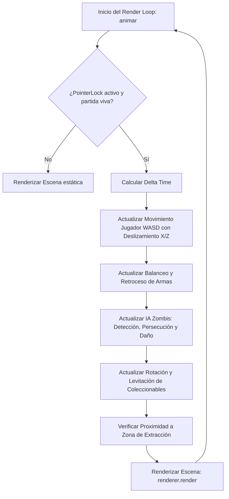

# Operación Extracción – Videojuego FPS 3D en Three.js

<div align="center">


<br/>

**Universidad Privada del Norte (UPN) · Computación Gráfica y Visual**  
_Evaluación T3 – Trabajo práctico de desarrollo (Semana 13)_  
**Ponderación:** 30 % del promedio final
<br/>

[](https://interezante456-pixel.github.io/T3-computacion-grafica/)
[](https://github.com/interezante456-pixel/T3-computacion-grafica)

</div>

---

## 📋 Tabla de Contenidos

1. [Descripción del Proyecto](#1-descripción-del-proyecto)
2. [Requisitos y Ejecución Paso a Paso](#2-requisitos-y-ejecución-paso-a-paso)
3. [Estructura Profesional del Proyecto](#3-estructura-profesional-del-proyecto)
4. [Controles del Videojuego](#4-controles-del-videojuego)
5. [Matriz de Requerimientos Funcionales (Rúbrica T3)](#5-matriz-de-requerimientos-funcionales-rúbrica-t3)
6. [Arquitectura del Motor y Bucle Principal](#6-arquitectura-del-motor-y-bucle-principal)
7. [Sistema de Audio Procedural](#7-sistema-de-audio-procedural-web-audio-api)

---

## 1. Descripción del Proyecto

**Operación Extracción** es un videojuego tridimensional de disparos en primera persona (_First-Person Shooter_ o FPS) desarrollado de forma nativa en **Three.js** y **WebGL** bajo el paradigma _Zero-Build_ (sin intermediarios de compilación como Webpack o Vite).

El jugador asume el rol de un agente superviviente dentro de un complejo militar subterráneo invadido por una infección zombi. Su misión consiste en atravesar cinco sectores tácticos fuertemente custodiados, administrar cuidadosamente su munición, repeler hordas hostiles y alcanzar con vida la **Zona de Extracción** en el helipuerto final.

---

## 2. Requisitos y Ejecución Paso a Paso

- **Navegador web moderno:** Google Chrome, Mozilla Firefox, Microsoft Edge o Safari con WebGL 2.0 habilitado.
- **Servidor HTTP local:** Python 3 o la extensión **Live Server** de Visual Studio Code.
- **Conexión a Internet:** Para resolver la importación de Three.js (versión `0.180.0`) y sus complementos (_addons_) desde el CDN oficial de jsDelivr.
- **Sin `npm install`:** El proyecto utiliza módulos ES nativos (`type="module"`) y un mapa de importaciones (`<script type="importmap">`).

### Pasos para ejecutar:

1. Abre una terminal dentro de la carpeta del proyecto:
2. Inicia un servidor web local:

   **En Windows:**

   ```powershell
   python -m http.server 8000
   ```

   **En macOS o Linux:**

   ```bash
   python3 -m http.server 8000
   ```

3. Abre en tu navegador la URL:  
   👉 **[http://localhost:8000/](http://localhost:8000/)**

4. Haz clic en **«INICIAR OPERACIÓN»** para bloquear el ratón (_Pointer Lock_) y comenzar a jugar.

> **NOTA IMPORTANTE:** No abras el archivo `index.html` haciendo doble clic directo (`file:///`). Las políticas de seguridad del navegador (CORS) bloquearán la carga de los modelos binarios `.glb`. Es obligatorio ejecutar mediante servidor HTTP local o jugar online en GitHub Pages.

---

## 3. Estructura Profesional del Proyecto

```text
T3-computacion-grafica/
├── index.html                 # Interfaz de usuario, HUD táctico y mapa de importaciones
├── styles.css                 # Diseño visual CSS3, mira (crosshair) y viñetas de daño
├── main.js                    # Núcleo del motor de juego estructurado en 10 pasos canónicos
├── LICENSE                    # Licencia MIT oficial
├── README.md                  # Manual del proyecto, rúbrica y controles
├── models/                    # Modelos tridimensionales binarios GLTF (.glb)
│   ├── pistola.glb            # Arma secundaria ligera táctica (9mm)
│   ├── rifle.glb              # Arma principal de asalto (M4)
│   ├── zombie.glb             # Enemigo humanoide infectado
│   └── caja_municion.glb      # Objeto coleccionable de abastecimiento
└── tools/
    └── generar_modelos.py     # Script generador en Python con trimesh
```

---

## 4. Controles del Videojuego

|         Control          | Acción                     | Detalle Técnico                                                     |
| :----------------------: | :------------------------- | :------------------------------------------------------------------ |
|         **`W`**          | Avanzar                    | Desplazamiento frontal con deslizamiento de muros                   |
|         **`S`**          | Retroceder                 | Desplazamiento hacia atrás                                          |
|         **`A`**          | Desplazarse a la izquierda | Movimiento lateral (_strafe left_)                                  |
|         **`D`**          | Desplazarse a la derecha   | Movimiento lateral (_strafe right_)                                 |
| **Movimiento del ratón** | Orientar cámara            | Perspectiva en primera persona con `PointerLockControls`            |
|    **Clic izquierdo**    | Disparar                   | Un disparo por clic (sin disparo automático al mantener presionado) |
|      **Tecla `1`**       | Seleccionar Pistola        | Equipa la Pistola 9mm con cambio visual inmediato                   |
|      **Tecla `2`**       | Seleccionar Rifle          | Equipa el Rifle M4 de alta potencia                                 |
|      **Tecla `R`**       | Recargar cargador          | Transfiere balas desde tu reserva al cargador activo                |
|     **Tecla `Esc`**      | Pausar / Liberar ratón     | Libera el puntero del navegador                                     |

---

## 5. Matriz de Requerimientos Funcionales (Rúbrica T3)

|    ID    | Requerimiento Funcional              |    Estado    | Justificación Técnica                                                                                                                                         |
| :------: | :----------------------------------- | :----------: | :------------------------------------------------------------------------------------------------------------------------------------------------------------ |
| **RF01** | **Sistema de armas**                 | **CUMPLIDO** | Dos modelos GLB independientes (`pistola.glb` y `rifle.glb`). Teclas 1 y 2 conmutan el modelo en primera persona. Disparo único en `mousedown`.               |
| **RF02** | **Sistema de municiones**            | **CUMPLIDO** | Contadores independientes. Cada disparo resta 1 bala. Se bloquea al llegar a 0. Recuperación únicamente recogiendo cajas de munición en el 3D.                |
| **RF03** | **Construcción del mundo 3D**        | **CUMPLIDO** | Complejo militar de 140+ metros con 5 sectores: _Inicio_, _Pasillo Alfa_, _Laboratorio_, _Túnel de Emergencia_ y _Helipuerto final_. Colisiones AABB sólidas. |
| **RF04** | **Zombis en GLB**                    | **CUMPLIDO** | Enemigos cargados asíncronamente desde `zombie.glb`, normalizados con `THREE.Box3` y proyectando sombras suaves.                                              |
| **RF05** | **Comportamiento inteligente**       | **CUMPLIDO** | Máquina de estados: inactivo fuera de rango (`> 15 m`) y activo en persecución al entrar en rango. Distancia de activación configurable.                      |
| **RF06** | **Cámara y movimiento FPS**          | **CUMPLIDO** | Controles WASD con desacoplamiento de ejes para deslizamiento fluido. Arma montada en la cámara con retroceso (_recoil_) y balanceo dinámico.                 |
| **RF07** | **Disparos y colisiones**            | **CUMPLIDO** | Detección mediante `THREE.Raycaster`. Los zombis mueren **exactamente al segundo impacto válido** y dejan de atacar de inmediato.                             |
| **RF08** | **Progresión y extracción**          | **CUMPLIDO** | Plataforma de helipuerto con baliza verde luminosa. Al ingresar, muestra el mensaje oficial: **«¡MISIÓN COMPLETADA! Has llegado a la zona de extracción»**.   |
| **RF09** | **Condición de derrota (Game Over)** | **CUMPLIDO** | Ataque cuerpo a cuerpo a menos de $1.30\text{ m}$. Si la salud llega a 0%, se detiene la partida con mensaje **GAME OVER** y botón para reiniciar.            |
| **RF10** | **Objetos coleccionables**           | **CUMPLIDO** | Cajas de munición con halo luminoso que levitan y rotan. Al acercarse a $< 1.8\text{ m}$, suman +30 balas a la pistola y +25 al rifle.                        |
| **RF11** | **Dificultad del juego**             | **CUMPLIDO** | 12 zombis distribuidos estratégicamente, munición finita y barricadas tácticas que exigen habilidad de movimiento y puntería.                                 |
| **RF12** | **Repositorio y demostración**       | **CUMPLIDO** | Repositorio GitHub público, manual técnico, código limpio y guion para el video de 3 minutos.                                                                 |

---

## 6. Arquitectura del Motor y Bucle Principal



---

## 7. Sistema de Audio Procedural (Web Audio API)

Para garantizar la máxima confiabilidad durante la revisión del profesor (evitando errores 404 por archivos MP3 ausentes o bloqueos de red), todos los sonidos se generan mediante síntesis procedural en tiempo real:

- `reproducirSonidoPistola()`: Frecuencia descendente rápida emulando un disparo 9mm seco.
- `reproducirSonidoRifle()`: Onda de diente de sierra profunda con cuerpo grave para el M4.
- `reproducirSonidoRecarga()`: Doble pulso mecánico emulando expulsión e inserción de cargador.
- `reproducirSonidoVacio()`: Clic de percutor metálico al quedarse sin balas.
- `reproducirSonidoImpacto()`: Impacto acústico sordo al acertar un disparo sobre el zombi.
- `reproducirSonidoMuerteZombi()`: Gruñido gutural descendente al neutralizar al enemigo.
- `reproducirSonidoColeccionable()`: Arpegio mayor tríada ($C_5, E_5, G_5$) al recoger suministros.
- `reproducirSonidoVictoria()`: Fanfarria de victoria en 5 notas armónicas.

---
